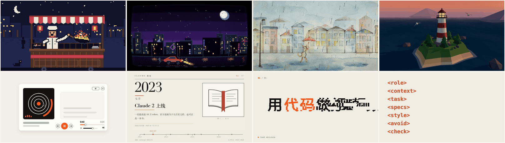

<h1 align="center">code-video</h1>

<p align="center">
  <em>Make short videos with code. The agent asks what you want, writes a prompt for it, draws every frame and hands you an MP4.</em>
</p>

<p align="center">
  
  
  
  
</p>

<p align="center">
  <sub><a href="README.zh-CN.md">简体中文</a></sub>
</p>

---

<p align="center">
  <br>
  <sub>made from the seven reference prompts — top: pixel art · retro arcade · hand-drawn · low-poly 3D; bottom: UI motion · history explainer · one line, free rein · the seven-block prompt</sub>
</p>

An agent skill for making short videos and animations without a video editor. Claude doesn't generate video; it writes code. Here the code is a web page that draws second *t* of the video with Canvas, WebGL, SVG, p5.js or Three.js, and `render.mjs` screenshots it frame by frame in a headless browser and pipes the frames into FFmpeg. A different look is a different way of drawing: pixel art is a tiny canvas scaled up with smoothing off, an old TV is a shader laid over it, hand-drawn is a brush library that redraws twelve times a second.

Most of the skill is about what happens before the code. The agent **asks first**, one round, at most five questions: where the video goes and who watches it, what to show, which look, size and length, what to avoid. Then it **fills in a prompt for this request**: the agent writes every block itself, and the look is a recommendation, not a rule; it can pick from the seven tested references or design something new. It shows you the prompt, builds once you say OK (or hands the prompt to a subagent with a clean context), checks sampled frames against the prompt's own checklist, adds any unwanted habits that showed up, and hands you the folder. The skill itself stays light: a path, a few hard rules (frames depend only on time, facts sourced, assets licensed) and the tools; how the video looks is left to the agent.

## The prompt: six blocks, filled by the agent

| Block | What goes in | Why |
|---|---|---|
| `role` | a concrete identity and what it cares about most | a motion designer pushes rhythm and transitions, an explainer writer pushes accuracy; picked per video type |
| `context` | where it's used, who watches, so what's needed | once the model knows why, it fills in what you didn't write |
| `task` | what to show, in what order, what viewers should remember | your words first |
| `specs` | size, frame rate, length, loop or not, sound or not | "30 frames per second", never "30 frames" — that was read as 30 frames in total |
| `style` | recommended technique and look, each with a reason, plus what you don't want, by name; a recommendation, not a rule | pixel art: tiny canvas, integer scale, smoothing off, ≤ 16 colors; "don't make it look AI-made" only swaps one default look for another, so name the specific thing |
| `check` | what to inspect in sampled frames | specific beats vague: holes in 3D, color count in pixel art, dates in a history |

The tag names are this skill's own (the tested examples below still have a separate `avoid` block; it now lives in `style`). Anthropic's [prompting guide](https://platform.claude.com/docs/en/build-with-claude/prompt-engineering/claude-prompting-best-practices) recommends separating instructions, context and examples with consistently named XML tags, explaining why, and naming what you don't want; it doesn't prescribe a fixed set of tags.

<details>
<summary>Example: the pixel-art prompt (translated from the tested Chinese original; 【】 marks what you fill in)</summary>

```
<role>
You are a pixel artist who knows how old games were drawn and timed, and you care most that every
pixel is clean and that what the character is doing reads at a glance. Draw every frame yourself in code.
</role>

<context>
This is for 【where it's used】. People watch on their phones, so it has to read instantly as old-game
pixel art, and what the character is doing has to be clear.
</context>

<task>
【where it is, who is doing what, what else moves in the background】
</task>

<specs>
- 【landscape 1920×1080 / portrait 1080×1920】, 30 frames per second, 【8】 seconds
- The motion never repeats, and the end flows back into the start so it can loop
- Everything drawn in code, no image assets; render to MP4
</specs>

<style>
Use Canvas. Draw on a tiny canvas first (192×108 landscape, 108×192 portrait), then scale up by an
integer factor with smoothing off, and round every coordinate, so every pixel is a crisp square.
No more than 16 colors. The character changes pose only about 10 times a second while fire, smoke and
water move every frame — that stop-and-go rhythm is what makes it feel like an old game.
</style>

<avoid>
Gradients, blur, glow, transparency; text in the picture; existing game characters and logos.
</avoid>

<check>
When done, put 5 sampled frames on one sheet and go through them: are the character's hands, feet and
props ever detached or misplaced; is the character still recognizable at phone size; are there more
than 16 colors; does the end meet the start. Fix anything wrong before handing it to me.
</check>
```

</details>

## Seven reference looks

If you can't say what look you want, the agent recommends two or three of these and writes a new prompt modeled on them. Looks combine: retro arcade is pixel art with a CRT shader on top.

| Look | Drawn with | What makes it work |
|---|---|---|
| Pixel art | Canvas 2D | a 192×108 canvas scaled up ×10 with smoothing off, ≤ 16 colors, poses change about 10 times a second |
| Retro arcade | Canvas 2D + WebGL shader | pixel art first, then a CRT pass over the finished frame: curved glass, scanlines, phosphor dots, bloom, vignette |
| Hand-drawn picture book | p5.js + p5.brush | paper texture, pencil lines, watercolor; 12 drawings a second, each line jittering slightly |
| Low-poly 3D | Three.js | a scene built from boxes, cylinders and spheres, soft light and shadows, a slow orbit |
| UI motion / product promo | HTML + CSS + SVG | springs on every change, a cursor that drives each change, changes landing on the half beat of synthesized music |
| History explainer | HTML + CSS + SVG | print layout, serif years, page turns on the beat; every date verified online, anything unverifiable left out |
| One line, free rein | whatever it likes | "you're a great motion designer" plus a theme, a palette and a number of scenes, so the result is stable run to run |

The seven prompts in `references/examples/` are the ones that made the animations above (only the `role` lines were rewritten afterwards, per video type). They are in Chinese; the agent writes yours in your language. With Claude Opus 5.5 in Claude Code, a pixel-art loop took about 37 minutes from prompt to MP4, the UI promos 24–30 minutes, the hand-drawn piece about an hour.

For broad types such as explainers and intros the prompt doesn't fix a tech stack: the agent picks a technique per point (a timeline for chronology, 3D for structure, step-by-step formulas for math, charts for numbers) and keeps one palette and one pair of fonts across the video. `references/tech-stack.md` lists which library fits which look and how each one plugs into the frame-by-frame renderer, including untested options such as GSAP, PixiJS, Lottie, Manim, Remotion and Blender.

## Quick start

In Claude Code:

```
/code-video an 8-second pixel-art loop of a night-market cook flipping a wok
/code-video a 10-second portrait promo for my habit-tracker app
/code-video a 30-second brief history of the transistor
```

In any other coding agent:

```
Read the code-video SKILL.md in this repo and make a low-poly 3D animation of a lighthouse at dusk
```

The agent asks whatever it still needs, shows you the prompt, builds, checks, and hands you a folder:

```
your-video/
  video.mp4                 the result
  prompt.md                 the prompt it worked from; edit a block and ask for a re-render
  check/contact-sheet.png   the sampled frames it checked
  index.html, video.json    the drawing code and the size / fps / length
```

## Requirements

- A coding agent that can run commands on your machine (Claude Code, Codex, Cursor …)
- Node.js 18+ and FFmpeg on the PATH
- Python 3 with Pillow for the check scripts; numpy when the video has synthesized music
- Playwright, which the agent installs into each project folder (`npm i playwright`, and `npx playwright install chromium` the first time)
- The scripts use bash: macOS or Linux; on Windows, WSL or Git Bash

Developed and tested on macOS (Apple Silicon), where WebGL runs on the GPU through Metal. Linux should work: without a usable GPU, Chromium falls back to SwiftShader and WebGL-heavy pieces render more slowly.

## Install

Paste into any coding agent:

```
Install the code-video skill from https://github.com/Win-Hao/code-video
```

Or the [skills CLI](https://github.com/vercel-labs/skills):

```bash
npx skills add Win-Hao/code-video -g
```

Claude Code plugin (tracks this repo, updates on release):

```
/plugin marketplace add Win-Hao/code-video
/plugin install code-video@code-video
```

Manual (copies the files, pins the current version):

```bash
git clone https://github.com/Win-Hao/code-video.git
cp -R code-video/skills/* ~/.claude/skills/   # Claude Code
cp -R code-video/skills/* ~/.codex/skills/    # Codex
```

## Update

Match your install method:

```bash
claude plugin update code-video@code-video   # plugin (or: /plugin marketplace update code-video)
npx skills add Win-Hao/code-video -g        # skills CLI: re-running add refreshes it
```

Manual copies: pull (or re-clone) the repo and re-run the `cp -R`.

## Render without an agent

Any page that defines `window.render(t)` works:

```html
<!-- index.html -->
<style>html, body { margin: 0; overflow: hidden }</style>
<canvas id="c" width="1920" height="1080"></canvas>
<script>
  const ctx = document.getElementById('c').getContext('2d');
  window.render = t => {
    ctx.fillStyle = '#F3EEE4'; ctx.fillRect(0, 0, 1920, 1080);
    ctx.fillStyle = '#D4542B'; ctx.fillRect(160 + t * 400, 480, 120, 120);
  };
  window.__ready = true;
</script>
```

```bash
echo '{"name":"video","private":true}' > package.json
echo '{"width":1920,"height":1080,"fps":30,"duration":4}' > video.json
npm i playwright && npx playwright install chromium
S=path/to/skills/code-video/scripts
node $S/render.mjs index.html --stills 0,2 --outdir check   # a few stills first
node $S/render.mjs index.html video.mp4                     # add --audio music.wav for sound
bash $S/contact.sh video.mp4 check/contact-sheet.png        # frame 0 + 5 evenly spaced + last
```

`render.mjs` serves the current folder, waits for `window.__ready`, calls `render(t)` for every frame and pipes the screenshots into FFmpeg (H.264, BT.709). If `render(t)` returns a key equal to the previous frame's, the frame isn't captured again, which keeps 12-drawings-a-second animation fast.

## Design notes

- **Ask, then write the prompt for this request.** A one-line "go wild" prompt gave a different look on every run; writing the theme, the palette and the number of scenes into it made it stable.
- **Say why.** With "viewers should get what the app does at a glance" in the context, the model labeled every segment of a promo with the feature name on its own.
- **Name the clichés.** "Don't make it look AI-made" just trades one default look for another (Anthropic's guide for Opus 5.5 makes the same point about frontend design). Name them in `style`: no purple neon, no gradient buttons, nothing fading in all at once.
- **Frames depend only on time.** No timers, no requestAnimationFrame, seeded random numbers: the same `t` always draws the same picture, so a re-render is identical and any frame can be checked on its own.
- **Check the transitions.** In testing, most real defects (blank frames, things leaving the frame, parts flying off) showed up at the moment of a transition, which evenly spaced samples miss. The skill renders the first two frames of every transition as stills.
- **Use a real spring.** Improvised spring formulas often settle within the first 20% of the move and read as teleporting; the skill ships a damped spring, and an ease curve for cursors, because a spring overshoots and the cursor misses its target.
- **Pixel art needs integer coordinates.** One fractional coordinate and Canvas anti-aliases, and a 16-color piece turns into several hundred colors. The check script counts colors on the rendered PNG, never on the compressed MP4.

## Repo layout

The skill itself lives in `skills/code-video/`:

| Path | What it is |
|---|---|
| `SKILL.md` | the workflow: ask → write the prompt → build → check → deliver |
| `references/tech-stack.md` | which library for which look, how each plugs into the frame-by-frame renderer, untested options, when to ask before installing |
| `references/examples/` | the seven tested prompts, with notes on what went wrong in testing |
| `scripts/render.mjs` | page → frames → MP4 (Playwright + FFmpeg), or stills |
| `scripts/contact.sh` | contact sheets from a video or a folder of stills |
| `scripts/check.py` | count the colors in a still; compare the first and last frames of a loop |

## License

[MIT](LICENSE)
